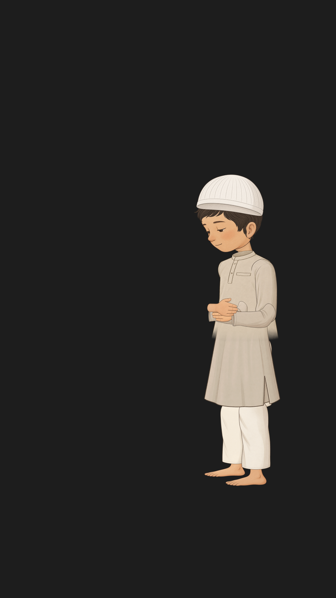
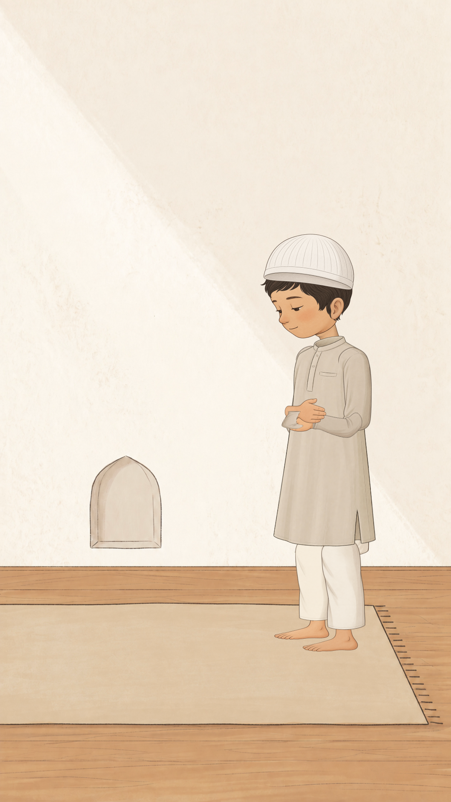
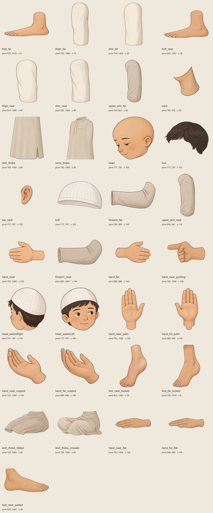

# Finish the PrayerGuide rig in Rive

Start with `standing-rig-preview.rev`. It already contains the standing assembly, the required bone hierarchy, an initial cloth binding, and the breathing animation. The steps below complete the remaining contract. They are instructions, not a claim that those steps are already finished.

The screenshots below are captures from the actual Rive CLI renderer. They show the supplied rig, not mockups of editor controls. The dark background is the renderer's backdrop; the artboard is transparent.

## 1. Open the editable standing rig

Import `standing-rig-preview.rev` into the Rive editor. Save your working copy as `PrayerGuide`. Select the artboard and confirm its name is `PrayerGuide`, its width is `1080`, and its height is `1920`. Keep the background transparent.

If you need to rebuild from PNGs, import the files in `parts/` at 50% scale. Position each full image at top-left `(0, 0)`, which puts the image center at `(540, 960)`. Do not position the full-canvas PNG at its visible part's bounding-box origin.

Alternatively, import the smaller files in `editor/` at 50% scale. Set their top-left position to `parts[].bounds.x` and `parts[].bounds.y` in `layout.json`. These cropped files contain the same artwork.



## 2. Check the room and standing proportions

Use `room.jpg` as a locked reference at `(0, 0)` with display size `1080 × 1920`. Remove this reference before the final transparent runtime export, because the app draws the room separately.

Match the supplied flattened preview. The kufi begins at y=560. The near foot touches y=1560, and the far foot sits slightly higher in perspective. Both feet must remain inside the mat. The room has been raised to satisfy the user's chosen y=1560 alignment.



## 3. Confirm complete parts and draw order

Hide surrounding parts one at a time. Check that shoulders, elbows, wrists, hips, knees, and ankles have filled overlap areas. Keep the complete overlap even when it is hidden in standing.

Use `layout.json` as the draw-order reference. `zOrder=0` is the back. Larger values draw in front. In the editor's hierarchy, the front items appear above the back items. Keep `hand_near_pointing` hidden at rest.

Keep `ear_near` above `hair`. The head still contains the full face and ear beneath this overlay. The two trouser sections are already part of each leg; do not add duplicate trousers.

Before final export, refine the waist blend and far-wrist overlap. Check these joints against a contrasting background as well as the room.



## 4. Confirm the bone hierarchy and pivots

Use the exact names below. The `bones` array in `layout.json` gives each joint's world position and its parent-relative transform. Its angles are explicitly labelled as degrees or radians.

```text
hips
├── spine
│   └── chest
│       ├── neck
│       │   └── head
│       ├── upper_arm_near
│       │   └── forearm_near
│       │       └── hand_near
│       └── upper_arm_far
│           └── forearm_far
│               └── hand_far
├── thigh_near
│   └── shin_near
│       └── foot_near
└── thigh_far
    └── shin_far
        └── foot_far
```

The source uses positionable `RootBone` objects nested within this hierarchy. This preserves the specified joints, including the shoulders' offset from the chest. Do not replace them with tip-attached bones without preserving their world positions.

## 5. Refine mesh weights and test the joints

Select `torso_thobe`, enter its mesh, and inspect the existing 5-column, 9-row grid. Its upper region follows `chest`, its middle follows `spine`, and its lower region follows `hips`. Blend the intermediate rows smoothly.

Select `skirt_thobe` and inspect its separate 5-column, 9-row grid. The initial weights progress from `hips` to `thigh_near` to `shin_near`. Add far-leg influence where the cloth needs to follow the other leg during sitting and crossing. Refine the grid at the hip fold, knee fold, and side slit. Keep the torso-skirt overlap covered throughout the bend.

Bind rigid artwork with 100% influence from its named bone. Bind `head`, `hair`, `kufi`, and `ear_near` to `head`. Bind both near-hand alternatives to `hand_near`. The preview implements rigid binding with four-vertex meshes and a single tendon.

Rotate each shoulder, elbow, hip, knee, and ankle through the range used by the poses. Inspect for gaps, stretched outlines, and exposed overlap contours. Undo these test rotations before you create the pose timelines. The supplied screenshots establish standing and breathing only, not this full range test.

Rive's [mesh documentation](https://rive.app/docs/editor/manipulating-shapes/meshes) describes the current **Deform → Mesh** controls and the difference between contour editing and deformation.

## 6. Prepare the artwork changes that a flat rotation cannot produce

Create two matching head-turn variants using the supplied salam references. Keep the camera fixed. `salamRight` turns the boy's head away from the viewer and reveals the back of the kufi. `salamLeft` turns toward the viewer. Do not mirror the existing head or rotate it within the image plane to imitate either turn.

Use a head-view group or Solo under the same head bone. Each alternative must include a matching face, hair, and kufi view. Keep all head artwork rigidly bound to that one bone. Key the selected view at frame 0 in every pose. These alternate views are not included in this first parts package.

Check whether the supplied open hands show the required surface for each pose. Author palm-facing variants for takbir and cupped palms for `after` where the side-view open hand cannot represent them. Add tucked-toe and upright-foot artwork if a rigid rotation of the existing feet gives the wrong contact shape. Keep the supplied parts and their names unchanged when adding these variants.

## 7. Create the ten single-keyframe posture animations

Set the animation frame rate to 60 fps. Keep the existing `standing` animation. Duplicate it nine times and use the exact names below. Put every pose key at frame 0. A one-frame duration is sufficient to hold a pose.

Key every bone property that differs between poses, every variant selection, visibility, and any draw-order change at frame 0 in every timeline. This prevents the last pose's hidden hand or turned head from leaking into the next pose. Keep breathing scale keys exclusively in `idle`.

For each animation, use the matching reference for identity and composition, and use the written contract when the reference differs from it.

| Input | Animation | Pose to author at frame 0 |
| --- | --- | --- |
| 0 | `standing` | Upright. The right, far hand rests over the left, near hand on the chest. Eyes down. |
| 1 | `takbir` | Upright. Both open hands beside the ears, with palms forward. |
| 2 | `bowing` | Rotate the upper body forward 90°. Keep the back flat, head in line with it, legs straight, and hands on the knees. |
| 3 | `rising` | Upright, with both arms relaxed at the sides. |
| 4 | `prostrating` | Knees on the mat. Forehead and nose contact the mat. Palms lie beside the shoulders. Elbows stay raised. Toes tuck under. |
| 5 | `sitting` | Sit on the left foot. Keep the right foot upright. Both hands lie flat on the thighs. |
| 6 | `tashahhud` | Start from sitting. Hide `hand_near`, show `hand_near_pointing`, and direct the eyes toward its index finger. This follows the requested near-hand swap. |
| 7 | `salamRight` | Keep sitting. Select the head view turned to the boy's right, away from the viewer, with the back of the kufi visible. |
| 8 | `salamLeft` | Keep sitting. Select the head view turned to the boy's left, toward the viewer. |
| 9 | `after` | Sit cross-legged. Raise open palms in front of the chest and use a calm smile. |

Fold the cloth meshes with the hips and knees in the seated poses. Do not hide a tear between the torso and skirt with the room background. Check the same pose on transparency.

## 8. Preserve the three-second breathing loop

Keep `idle` at 180 frames and 60 fps, with loop playback. The chest scale has keys at frame 0 with value `1`, frame 90 with value `1.02`, and frame 180 with value `1`. Both scale axes use these values. Use ease-in-out interpolation on the first two keys.

The animation contains only the chest scale properties. Put it on a separate state-machine layer so it runs over every posture. Check prostration especially: breathing must not lift the forehead, nose, palms, or knees from the mat. Add contact constraints or refine the cloth binding if needed.


## 9. Build the Guide state machine

Create a state machine named exactly `Guide`. Set it as the artboard's default state machine. Add one Number input named exactly `pose`, with default value `0`. Retain this Number input API even if the editor recommends view models.

Create a layer named `Poses`. Add one animation state for each of the ten posture timelines. Connect Entry to `standing`. Connect Any State to each posture state and add exactly one equality condition, `pose == n`, using the values in step 7.

Select the ten Any State transitions together. Set their duration to 1200 ms, or 1.2 seconds if the editor displays seconds. Turn percentage duration off. Turn Exit Time off. Use cubic ease-in-out with control points `(0.42, 0)` and `(0.58, 1)`. Allow interruption during a transition so a new input can change direction immediately.

Do not add unconditional returns, transitions to Exit, or explicit transitions from a pose back to itself. Test an unchanged input by leaving `pose=5` for at least ten seconds and assigning `5` again. The pose must hold and breathing must continue without a posture restart. Repeat this test during an active transition. Treat any restart as a failed controller check, not an acceptable app-side workaround.

Use Rive's [transition controls](https://rive.app/docs/editor/state-machine/transitions) to set duration, conditions, and interpolation. The completed machine must keep the single-input contract.

## 10. Add the idle layer

Create a second layer named `Breathing`. Add one state that plays `idle` in a loop. Connect its Entry directly to that state. Add no pose conditions to this layer.

Remove `StandingPreview` from the production file after `Guide` works. The preview's two-layer setup is a working reference for separating pose transforms from chest scale.

## 11. Check every pose and transition

Capture each pose over `room.jpg`, then on transparency. Check all ten against step 7. Inspect the waist, knees, shoulders, and wrists at 200% zoom. Confirm that the pointing hand disappears after tashahhud and that both salam directions match the boy's own left and right.

Drive `pose` through `0 → 1 → 2 → 3 → 4 → 5 → 6 → 7 → 8 → 9`, then back to `0`. Test reversing during a transition and repeatedly assigning an unchanged value. Check that every blend lasts 1200 ms and uses the requested ease.

Single-keyframe interpolation does not automatically preserve floor contact or a natural intermediate body path. Refine the rig and constraints where knees, hands, or the head cross the floor. Keep the ten endpoint timelines as single-keyframe poses.

## 12. Export the production files

Export the finished runtime as `guide-character.riv`. Export its editable file as `guide-character.rev`, or provide the editor share link. Keep `room.jpg` outside the runtime artboard. Record the runtime file size and include the ten verified pose screenshots.

Before handoff, reload the exported runtime in a Rive runtime or previewer. Select artboard `PrayerGuide`, state machine `Guide`, and Number input `pose`. Repeat the transition checks on that export. Do not substitute the supplied `standing-rig-preview.riv` for this final file.
